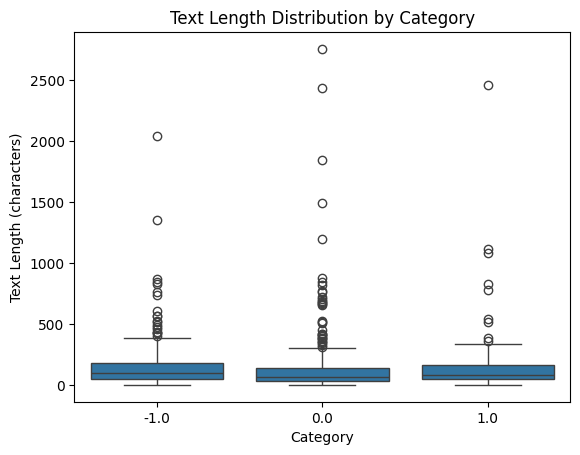
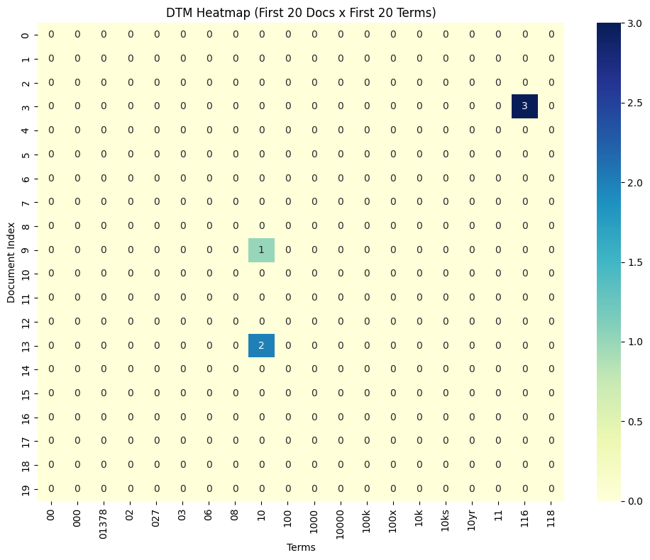
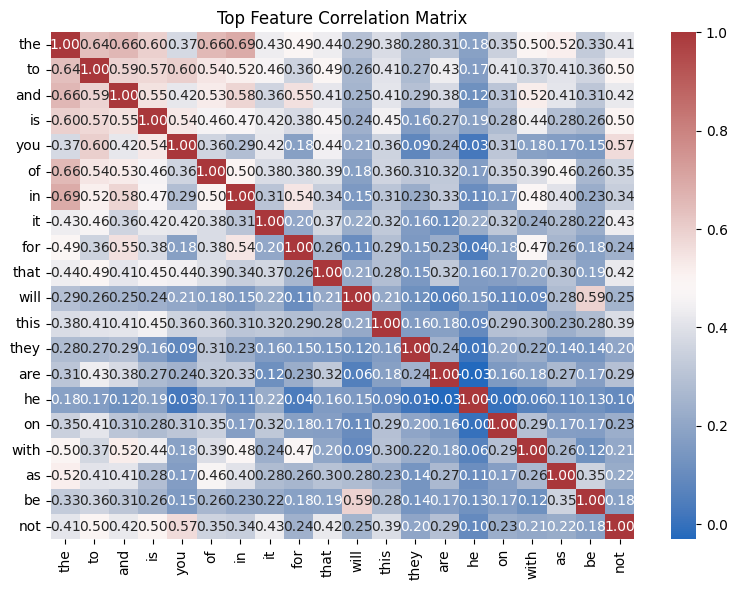
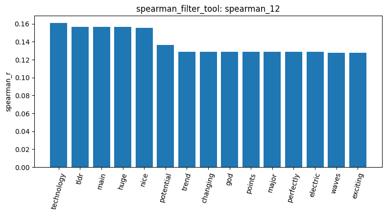
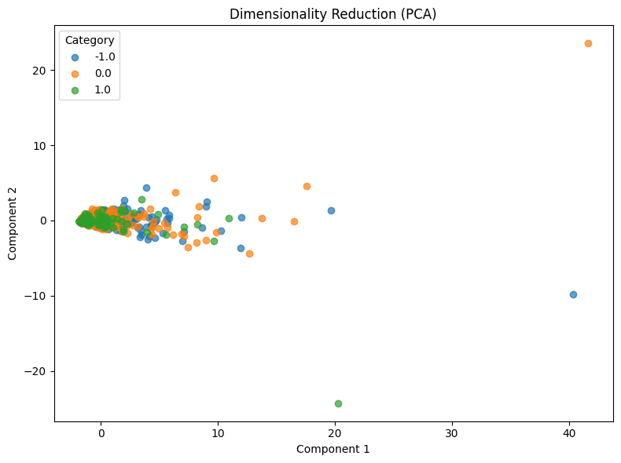
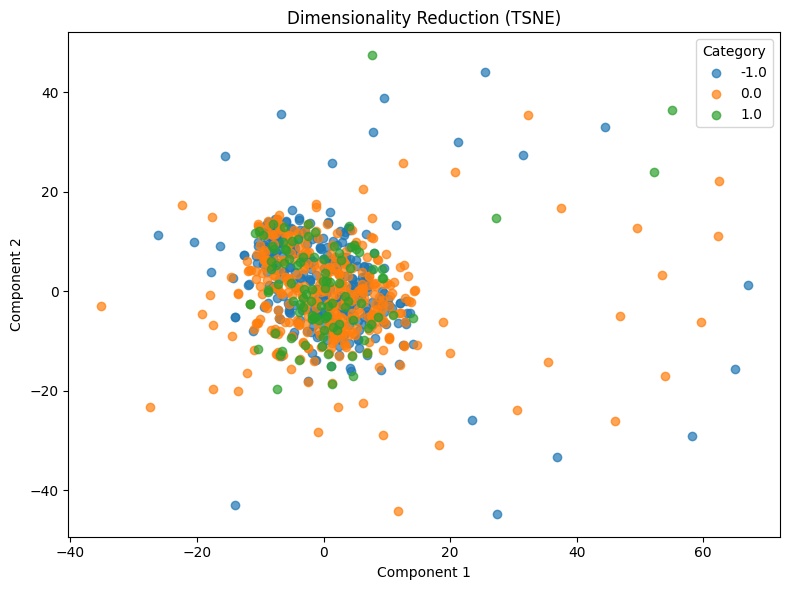

# Homework Report: Reddit Stock Sentiment

**Data and cleaning.** I loaded `newdataset/Reddit-stock-sentiment.csv` with `text` as the document and `label` as the category (`load_dataset_1`). The file has 847 rows: 423 neutral (`0.0`), 315 negative (`-1.0`) and 109 positive (`1.0`), so the classes are clearly imbalanced. There are no missing texts (`check_missing_2`). There are 11 groups of exact duplicates, covering 34 rows (`check_duplicates_3`: duplicate_count 23). I checked them in the CSV: all are templated bot posts such as stockbuyvest.com daily link dumps ("Gappers for today", "Daily Shorts"), all labeled 0.0. Following the Master notebook's `keep=False` rule, I dropped every copy (`check_duplicates_5`), leaving 813 documents (315 / 391 / 107). The texts are very short (`describe_data_6`). The median is 80 characters, against about 1,235 for 20-newsgroups. Negative comments are the longest (median 96), neutral the shortest (68), and positive in between (81). With only 813 documents I did not subsample. The tools needed no changes for this dataset: three string labels, much shorter texts and a much smaller vocabulary all worked unchanged.

**Document-term matrix and filtering.** The unigram DTM (`dtm_7`) is 813 × 4,313 with 16,659 non-zero cells, a sparsity of 99.525%. The agent predicted that shorter texts would make the matrix "closer to 100%" sparse. In fact it is almost identical to 20-newsgroups (99.547%), because the vocabulary shrank too (4,313 terms against 35,788), so each row has fewer words but also fewer columns. The top 20 terms (`term_freq_8`) are all stop words (*the, to, and, is, …*). Unlike 20-newsgroups there are no e-mail header tokens. The first 20 columns of the DTM are numbers (`00`, `000`, … `118`) and are almost all zero (`dtm_heatmap_9`). A variance filter with threshold 0.01 (`variance_10`) keeps only 490 of the 4,313 terms (about 11%, against about 15% on 20-newsgroups), because most words occur once or twice. The 20 highest-variance terms are again all stop words (`feature_correlation_13`).

**Correlation with positive sentiment.** For target class `1.0`, the strongest Pearson (`pearson_11`) and Spearman (`spearman_12`) correlations are weak, at most about 0.16, against 0.3–0.4 for sci.med. They are also hard to interpret: *tldr, huge, main, nice, technology, potential*, followed by *waves, ice, storms, 3d, crush, rklb, amd*. Many terms share exactly the same r. I checked the CSV: every term at r = 0.156 occurs in exactly 3 documents, all positive, and every term at r = 0.128 occurs in exactly 2. With a binary-like count, r depends only on how many positive documents contain the term, not on which ones. Several of these terms come from the same three promotional penny-stock posts on r/stockstobuytoday, and *rklb* and *amd* from two "Rate My Portfolio" comments. With only 107 short positive documents, correlation ranks rare words that happen to fall entirely in the positive class. It does not find sentiment vocabulary. This is the same failure mode as the Gordon Banks signature on 20-newsgroups: a few documents decide the ranking.

**Frequent patterns.** Using the `tfidf` filter (stop words removed) and Top-K mining with k = 20, both the positive (`mine_patterns_14`) and negative (`mine_patterns_15`) classes produce only single words. Support is a raw count, and the classes differ in size (107 against 315 documents), so I compare proportions. Negative comments are dominated by politics and trade: *trump* 45 (14% of negative documents), *china* 33 (10%), *tariffs* 16, *trade* 14. They also contain profanity (*fuck* 14) and negations (*don* 15, *doesn* 14). The clearest sentiment signal is *good*: 12 positive documents (11%) against 13 negative ones (4%). Much of the vocabulary is shared at about the same rate: *just* 14% vs 13%, *economy* 5.6% vs 5.4%, *tariffs* 4.7% vs 5.1%. The agent described the positive class as lacking political words, but by proportion *economy* and *tariffs* are just as common there. The difference between classes lies in a few evaluative and political words, not in the topic.

**Dimension reduction and similarity.** PCA (`reduce_pca_16`) explains 30.6% and 5.8% of the variance with its first two components. In the plot almost every document sits near the origin, a few long documents stretch along component 1, and the three labels are completely mixed. t-SNE with perplexity 30 (`reduce_tsne_17`) gives one central blob in which all three labels are interleaved, with scattered outliers around it. Neither method shows any sentiment structure, which is expected: bag-of-words counts capture topic, and here all three classes discuss the same topics. The labels binarize into 3 classes, giving an 813 × 3 matrix (`binarize_18`). This confirms the tool handles a different number of classes than 20-newsgroups. Two promotional positive posts (documents 3 and 163) have cosine similarity 0.373 (`cosine_similarity_19`), against 0.235 between the first post and a negative comment about tariffs and Powell (document 6, `cosine_similarity_20`). The higher value reflects shared promotional wording rather than shared sentiment.

**Conclusion.** All tools ran unchanged on the new dataset, so the implementation generalizes. What does not carry over is the analysis. On 20-newsgroups the categories are topics, and topic words eventually show up. On Reddit the label is sentiment, but the vocabulary is shared, the texts are short, and the positive class is small. As a result, frequency and variance pick stop words, correlation picks rare words from a few promotional posts, and PCA and t-SNE show no label structure. A sentiment analysis would need stop-word removal, TF-IDF or binary features with a minimum document frequency, handling of the class imbalance, and ideally n-grams that keep negation (e.g. "not good"). It would also benefit from removing promotional and bot posts beyond exact duplicates.
